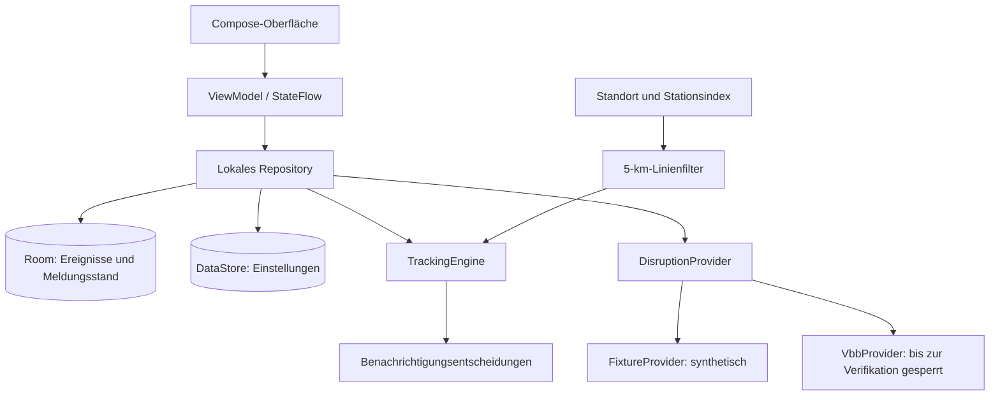

# Architektur und Entscheidungen

Stand: 21.11.2026. Native Android-App mit lokaler Diagnose und manuell ausgelöster Abfahrtsvorschau. Keine Konten, kein eigener Server und keine kostenpflichtigen Dienste.

## Zwei Module

- `core`: Kotlin/JVM ohne Android-Abhängigkeit. Domänenmodelle, austauschbare Provider, geografische Auswahl, konservative Ereignisverfolgung und Benachrichtigungsentscheidungen. Tests benötigen kein Android-Gerät.
- `app`: Compose/Material 3, ViewModel/StateFlow, lokale Room-Datenbank und DataStore-Einstellungen. Die erste Oberfläche demonstriert die Kernlogik ausdrücklich mit synthetischen Daten.

Die Übersicht lädt einen offline mitgelieferten GTFS-Index und prüft dessen Metadaten und Gültigkeit. Der separate Abfahrtsclient liest nur auf Anforderung Hinweise am Alexanderplatz. Er speichert den letzten Stand im ViewModel und schreibt ihn weder in das Demo-Ledger noch in den Entwarnungsalgorithmus. Standortadapter, Android-Geofencing, Kartenansicht, WorkManager und Android-Benachrichtigungen folgen in ihren Entwicklungsphasen.

## Linien und Stationen

Eine Linie besteht aus Region, Verkehrsmittel und Linienkennung. Stationen referenzieren eine Menge von Linien. Die Auswahl betrachtet alle Stationen innerhalb von einschließlich 5.000 m Luftlinie, vereinigt deren S-/U-Bahnlinien und filtert anschließend Ereignisse nach diesen Linien. Der Abschnitt des Ereignisses wird nicht erneut geografisch eingegrenzt.

Der spätere lokale Index wird aus `routes`, `trips`, `stop_times` und `stops` des freigegebenen GTFS-Datensatzes erzeugt. Alle Fahrtvarianten und Zweige müssen berücksichtigt werden; Haltestellen und Bahnsteige werden über stabile IDs verbunden. Eine textuelle Namensähnlichkeit reicht weder für Stations- noch für Ereignisidentität. Der offizielle Umkreissuch-Endpunkt ist wegen der dokumentierten Einschränkung derzeit kein Vollständigkeitsnachweis.

Standort- und Indexalter werden getrennt betrachtet. Ein kurzfristig fehlender Standort darf einen begrenzt alten letzten Zustand erhalten. Überalterte Daten ergeben einen sichtbaren unbekannten Zustand. Cache-Neuberechnung darf nicht durch kleine GPS-Schwankungen ausgelöst werden; die gewählte Distanz-/Zeitgrenze und damit verbleibende Verzögerung an der 5-km-Grenze sind im Kerncode ausdrücklich parametriert.

## Ereignisidentität und Entwarnung

Der Schlüssel besteht aus `(provider, providerEventId)`. Gleicher Titel oder gleiche Linie beweisen keine quellenübergreifende Identität. Unterschiedliche Provider werden nicht automatisch zusammengeführt. Wiederverwendete Quell-IDs benötigen künftig eine nachgewiesene Vorgangskennung.

Fachlicher Status und Datenfrische sind getrennt: Eine vormals aktive Meldung kann `MISSING` oder `STALE` werden, ohne dass die Einschränkung als aufgehoben gilt. Ein normalisierter Inhaltsfingerabdruck ignoriert reine Transportmetadaten. Relevante Änderungen an Abschnitt, Zeitraum oder Ersatzverkehr können eine Änderung erzeugen.

Eine Entwarnung verlangt gleichzeitig einen ausdrücklich aufgelösten Zustand, eine zur Quelle passende strukturierte Bestätigung und einen Provider, dessen Entwarnungssemantik zuvor verifiziert wurde. Veraltete und widersprüchliche Antworten dürfen einen abgeschlossenen Vorgang nicht wieder eröffnen. Eine belastbare Wiederaufnahme benötigt eine neue Vorgangsidentität.

**Nicht ausreichend:** fehlende Meldung, leere Antwort, abgelaufenes Prognoseende, HTTP 200, `act=false` ohne bestätigte Fachsemantik, Ende eines GTFS-Realtime-`active_period` oder unspezifische Freitextsuche.

Die Planungsfrist beträgt standardmäßig 14 Tage. Ein aus dem Zeitplan abgeleiteter Maßnahmenbeginn wird ausdrücklich von einer beobachteten Statusbestätigung unterschieden. Bereits benachrichtigte offene Ereignisse bleiben für Nachverfolgung vorgemerkt, auch wenn Standort oder Pausenstatus die aktuelle Linienauswahl ändern.

## Pausenorte

50 m bleiben Standard. Der fachliche Hybrid-Entscheider berücksichtigt Messgenauigkeit, Alter und mindestens zwei unterschiedliche Messungen über 30 Sekunden. Der Austritt verlangt zusätzlich einen 10-m-Entscheidungsabstand: selbst der nähere Rand des Genauigkeitsbereichs muss mindestens 60 m vom Mittelpunkt eines 50-m-Ortes entfernt sein. Dies ist eine konservative Austrittsprüfung, keine Änderung des gespeicherten Radius. WLAN ist ein unterstützendes Signal und kein alleiniger Beweis für Aufenthalt oder Austritt. Fehlende Berechtigung bedeutet unbekannt, nicht automatisch außerhalb.

Alle Orte werden lokal gespeichert. Eine separate Auswahl registriert höchstens 100 geeignete Geofences; sie löscht keine überzähligen Orte. Überlappende Zonen werden als Vereinigung behandelt. Die später benötigten Android-Adapter müssen Zustandswechsel und Neuregistrierungen nach Neustart ergänzen; Gerätemessungen sind verpflichtend.

## Persistenz und spätere Benachrichtigungen

Room speichert Ereignisse und den bereits gemeldeten Inhaltsstand gemeinsam in einer Transaktion. Ein Prozessneustart darf dieselbe Meldung nicht erneut zu einer neuen Warnung machen. Provider-Abfragefehler werden vom leeren erfolgreichen Snapshot unterschieden.

Die erste App zeigt Benachrichtigungsentscheidungen nur in der Diagnose. Vor echten Android-Meldungen wird eine persistente Outbox ergänzt: Zustandsänderung und ausstehender Auftrag werden atomar gespeichert, dann wird mit deterministischem `tag` und fester ID zugestellt und bestätigt. Ein Absturz zwischen Zustellung und Bestätigung führt damit zur Aktualisierung derselben Meldung. Erst nach diesem Adapter ist Zustellsicherheit implementiert; der aktuelle Fingerabdruck allein verspricht keine Exactly-once-Zustellung an Android.

Geplante Channels: akut, Bauarbeiten, Änderungen und Entwarnungen. Eine anfängliche Menge bestehender Ereignisse wird zusammengefasst. Ein gesperrter Channel oder verweigerte Berechtigung darf nicht fälschlich als erfolgreiche Zustellung verbucht werden.

## Hintergrundbetrieb und Datenschutz

Geplant: ein eindeutiger periodischer WorkManager-Auftrag mit standardmäßig 15 Minuten sowie zusammengefasste einmalige Prüfungen nach bestätigtem Zonenaustritt, relevanter Ortsänderung oder manueller Aktion. Netzwerkbedingung, Backoff und ein serialisierter Repository-Zugriff verhindern parallele Zustandskonflikte. WorkManager und Geofencing garantieren keine Echtzeit.

Die App fragt keine Standort-, Hintergrundstandort- oder Benachrichtigungsberechtigung ab. Der manuelle HTTPS-Abruf sendet die feste Stationskennung für Alexanderplatz an transport.rest. Es gibt keinen Standortverlauf, keine Analytics und keinen Kartenanbieter. Das Manifest setzt `allowBackup=false`. Weitere Berechtigungen sind erst beim Aktivieren der betreffenden Funktion vorgesehen.

VBB-Zugangsdaten werden nicht in APK, BuildConfig, Git oder Dokumentation eingebettet. Die offizielle Anforderung an Geheimhaltung steht bei öffentlicher Verteilung einer rein clientseitigen App entgegen. Ohne Freigabe eines passenden Zugangsmodells bleibt der Liveadapter gesperrt. Ein eigener Server wird nicht stillschweigend hinzugefügt.

## Bewusste Grenzen

Keine Wear-OS-App, kein Routenplaner, kein Scraping-Fallback, keine anderen Verbünde und keine Veröffentlichung. Die konkreten offenen Integrationsschritte stehen in `IMPLEMENTATION_PLAN.md`; Testergebnisse und nicht überprüfte Gerätefunktionen in `VALIDATION.md`.
